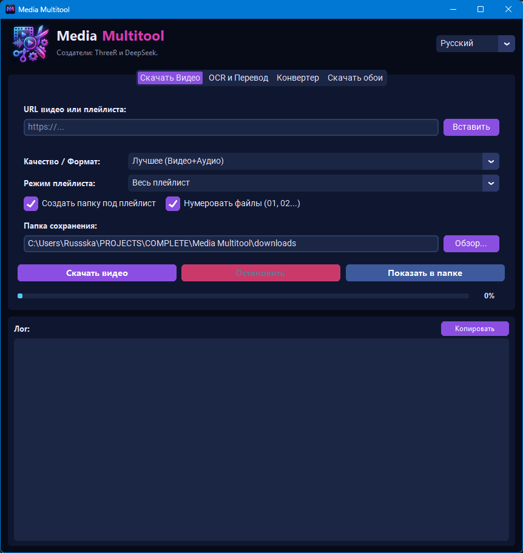
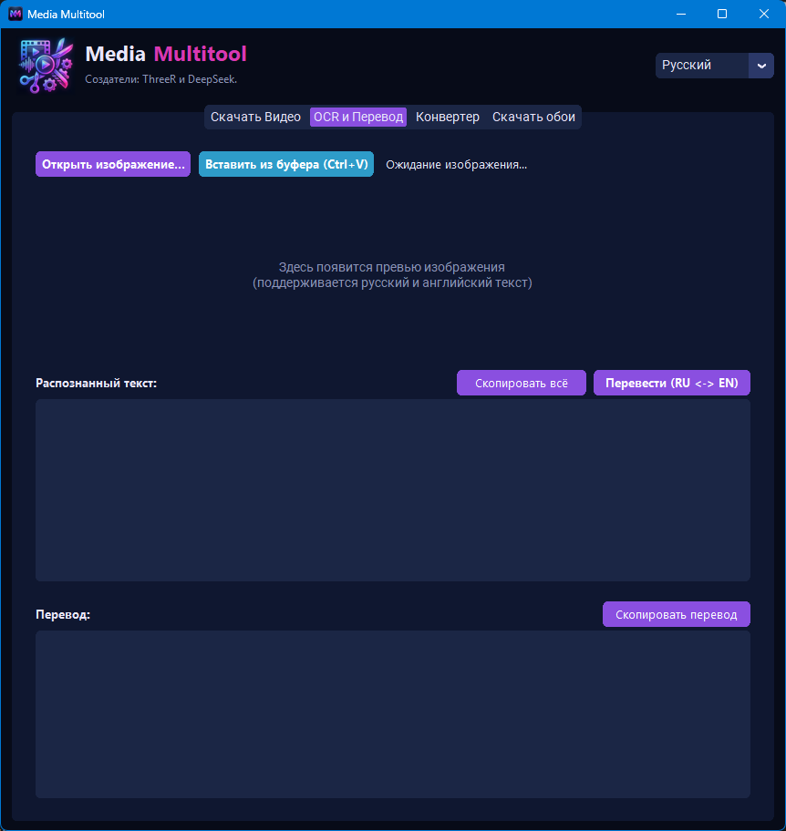

# Media Multitool

Программа для Windows: скачивание видео, распознавание и перевод текста с картинок, конвертация документов и скачивание обоев. Всё в одном окне, без установки.

## Возможности

- **Скачать видео** — YouTube и другие сайты через yt-dlp: выбор качества, плейлисты, диапазон элементов, папка сохранения.
- **OCR и перевод** — распознавание русского и английского текста с картинки или из буфера обмена, перевод RU ↔ EN.
- **Конвертер** — PDF → DOCX, PDF → PNG, изображения → PDF, объединение и разбиение PDF, видео и аудио.
- **Скачать обои** — WallpapersCraft и Wallhaven: категории, разрешения, пачка картинок со страницы.
- Один общий журнал: действия, прогресс и обновления в одном месте.
- Компоненты (yt-dlp, OCR-движок) обновляются сами с официального PyPI при запуске.

## Скриншоты

**Скачивание видео**



**OCR и перевод**



**Конвертер**


**Скачивание обоев**


## Скачать

**[Media.Multitool.Portable.zip](https://github.com/NoobDev68/Media-Multitool-releases/releases/latest/download/Media.Multitool.Portable.zip)** — 299 МБ, версия 1.0.1

1. Распаковать архив в любую папку — не в `Program Files`.
2. Запустить `Media Multitool.exe`.

Устанавливать ничего не нужно: Python, .NET Framework и ffmpeg уже внутри, интернет для работы не требуется.

**Требования:** Windows 10 или 11, 64-бит. Около 700 МБ на диске.

**Контрольная сумма** (SHA256):

```
08fb5394ca9ee677863682a76551d45a9585a82607ef36eaaadcdf4494c5029b
```

Проверка в PowerShell:

```powershell
certutil -hashfile "Media.Multitool.Portable.zip" SHA256
```

**SmartScreen.** Программа не подписана платным сертификатом, поэтому Windows может показать «Windows защитила ваш компьютер». Нажмите «Подробнее» → «Выполнить всё равно». Это стандартное предупреждение для новых неподписанных программ.

## Поддержать разработчика

Если программа оказалась полезной, можно угостить меня чашкой кофе:

**[☕ Купить чашечку кофе](https://boosty.to/threer/donate)**

В самой программе для этого есть кнопка **«☕ Отблагодарить автора»** в правом верхнем углу.

## Обновления

При запуске программа проверяет новые версии yt-dlp и OCR-движка на официальном PyPI и обновляет их с прогрессом в журнале. Служебные файлы обновлений лежат в релизах этого репозитория: `manifest.json` и `runtime-core-*.zip`.
