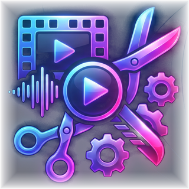
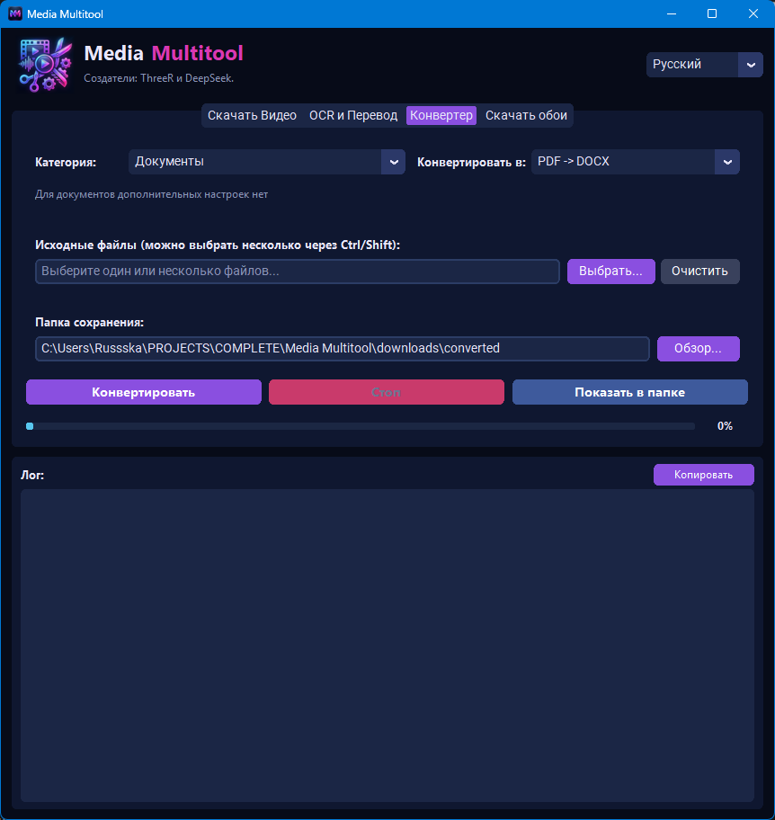
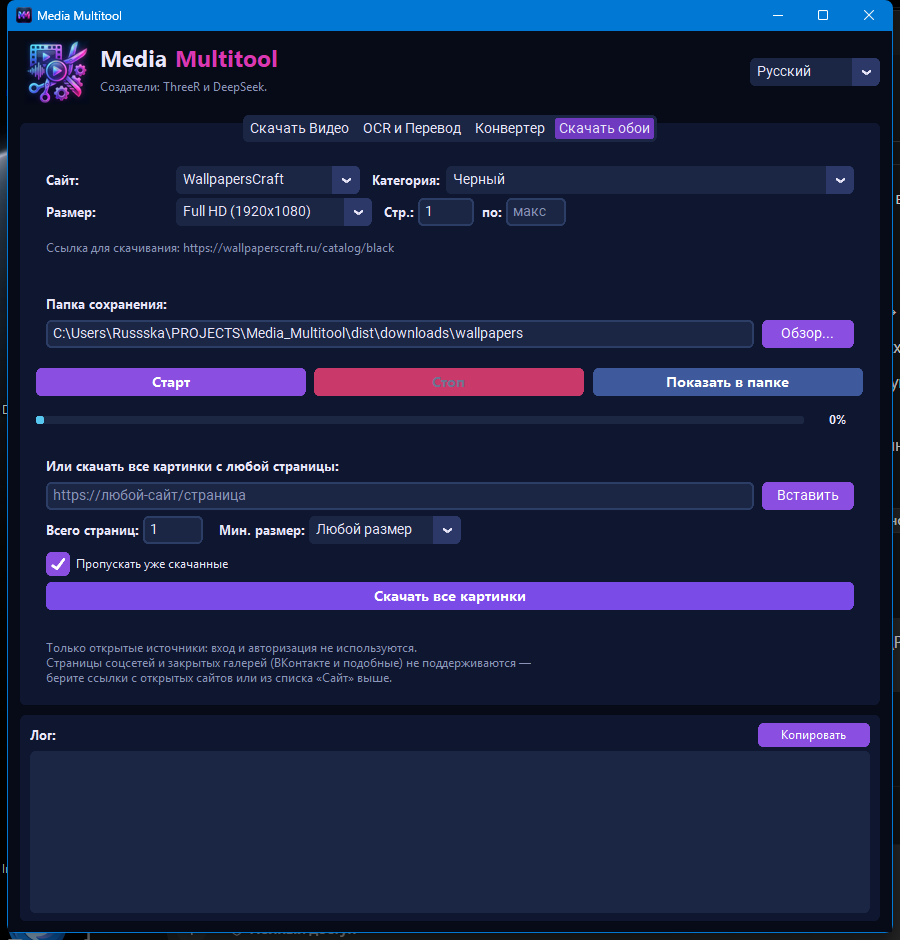

# Media Multitool


Портативная программа для Windows, которая заменяет несколько утилит:
скачивание видео, распознавание и перевод текста с картинок, конвертация
документов и скачивание обоев — в одном окне.

Один архив, без установки и без записей в реестр: настройки, загрузки и
компоненты лежат рядом с программой в папках `downloads\` и `runtime\`.

[**Скачать**](https://github.com/NoobDev68/Media-Multitool-releases/releases/latest) ·
[**Отблагодарить автора**](https://pay.cloudtips.ru/p/a87b504b) ·
[**Я на Boosty**](https://boosty.to/threer)



## Возможности

- **Скачивание видео** — YouTube и другие сайты через yt-dlp: выбор качества
  (1080p, 720p, только аудио), целые плейлисты и диапазон элементов, отдельная
  папка под плейлист и нумерация файлов.
- **OCR и перевод** — распознавание русского и английского текста с картинки
  или из буфера обмена. Результат можно скопировать и перевести RU ↔ EN прямо
  в окне, без сторонних сервисов.
- **Конвертер** — PDF → DOCX, PDF → PNG постранично, изображения → PDF,
  объединение и разбиение PDF, видео и аудио (перекодирование и remux).
- **Обои** — WallpapersCraft и Wallhaven: категория, разрешение, диапазон
  страниц. Плюс режим «любая ссылка»: собирает все картинки со страницы
  и фильтрует по минимальному размеру.
- **Один журнал** — все действия, прогресс, ошибки и обновления в одной панели.
  Его можно скопировать одной кнопкой.
- **Самообновление** — при запуске проверяются новые версии yt-dlp и OCR-движка
  на официальном PyPI и устанавливаются с прогрессом в журнале.
- Тёмная тема; русский и английский интерфейс переключается на лету, без
  перезапуска программы.


## Скачать и запустить

1. Скачать [**Media.Multitool.Portable.zip**](https://github.com/NoobDev68/Media-Multitool-releases/releases/latest/download/Media.Multitool.Portable.zip)
   из последнего релиза — 299 МБ.
2. Распаковать архив в любую папку, кроме `Program Files`.
3. Запустить `Media Multitool.exe`.

Устанавливать ничего не нужно: Python, .NET Framework и ffmpeg уже внутри,
интернет для работы не требуется.

Сборка не подписана, поэтому SmartScreen может предупредить — «Подробнее» →
«Выполнить в любом случае».

**Контрольная сумма** (SHA256):

```
e3501713fa959ca328c6cc6bb883b77424dd297f789ef82f97876813a7b9e2c5
```

Проверка в PowerShell:

```powershell
certutil -hashfile "Media.Multitool.Portable.zip" SHA256
```

## Скриншоты

**OCR и перевод**


**Конвертер**



**Скачивание обоев**



## Требования

- Windows 10 или 11, 64-бит.
- Около 700 МБ на диске: ядро, компоненты и ffmpeg.
- Интернет нужен только для обновления компонентов; сама программа работает офлайн.

## Обновления

При запуске программа читает официальный PyPI, сравнивает версии yt-dlp и
OCR-движка с установленными и обновляет устаревшие — с процентами в журнале.
Служебные файлы обновлений лежат в релизах этого репозитория: `manifest.json`
и `runtime-core-*.zip`.

## Ограничения

- Скачивание обоев работает только с открытыми страницами: сайты, требующие
  входа в аккаунт (соцсети, закрытые галереи), не поддерживаются.
- Без интернета обновления компонентов не проверяются — программа просто
  остаётся с текущими версиями.
- Ядро программы обновляется только новой сборкой: скачайте архив заново,
  чтобы получить новые функции. Компоненты обновляются сами.

## Поддержать проект

Программа бесплатная и портативная, без рекламы и подписок. Если она помогла —
можно отблагодарить автора: [**Отблагодарить автора**](https://pay.cloudtips.ru/p/a87b504b).

[**Я на Boosty**](https://boosty.to/threer).

В самой программе для этого есть кнопка **«☕ Отблагодарить автора»** в правом
верхнем углу.

## Лицензия

Программа распространяется как есть, без гарантий. Исходный код не публикуется.
